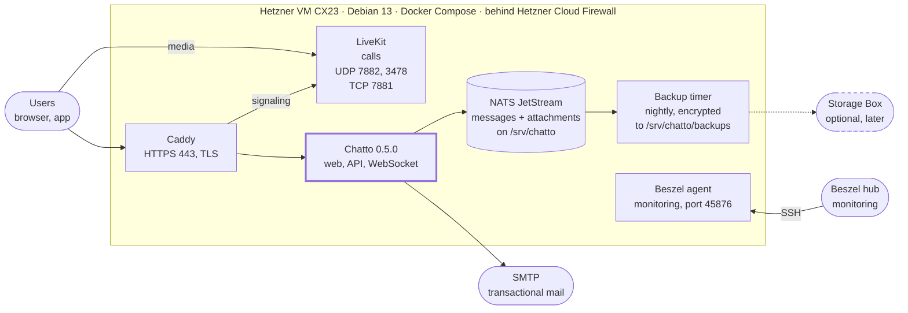

# Kalkspace Chatto – Design Document for the PoC

Nov 20, 2026 · @Kai

## Goal and scope

We are testing Chatto in a proof of concept (PoC) as a possible alternative to Slack for Kalkspace. The PoC should show whether Chatto is a good solution from the point of view of both users and admins. There is no decision to migrate away from Slack yet: the plenum decides that based on the experience from the PoC. The PoC runs on the smallest sensible Hetzner Cloud instance in Kai's own Hetzner project. The architecture nevertheless already matches a possible production setup: if the decision is positive, we rebuild the same setup from the repo in the Kalkspace infrastructure (probably also Hetzner Cloud).

This document is the specification for the implementation in a Git repo (OpenTofu/Terraform, Ansible, Docker Compose).

**In scope**

- One Chatto server on a Hetzner Cloud VM, fully reproducible from code
- Chat, files, voice/video calls (LiveKit), web push
- Backups, restore test, basic monitoring, update process

**Out of scope for the PoC**

- High availability, NATS cluster, multiple Chatto replicas, Kubernetes, external object storage (S3); S3 is only added if needed
- Central identity management (SSO/OIDC)
- The decision to switch and an actual Slack migration; the PoC only provides the basis for that, including an import dry run

## Requirements and assumptions

The load would be small even in production: just under 250 accounts, 10–20 of them regularly active. Besides suitability for users and admins, the PoC should show how few resources Chatto needs for this.

| Requirement | Decision |
| --- | --- |
| Users | \~250 accounts, 10–20 active; phase 1: a handful of testers |
| Login | Local accounts (email + password), no central IdP |
| Registration | Open: self-registration by email is allowed |
| Cost | As low as possible; only enlarge the instance when needed |
| Availability | Best effort, single host; an outage of minutes to hours is acceptable |
| Data loss | At most 24 h for logical errors such as operator mistakes or a broken update (daily backup). Losing the volume is accepted in phase 1, because the backups live on the same volume |
| Location | Hetzner, Germany (FSN1 or NBG1) |
| Reproducibility | Everything as code; the setup must be rebuildable at any time, including in a different Hetzner project |

**Assumptions**

- Domain: the test runs under `chat.cyb3rk4t.me`, the later target is `chat.kalk.space`. LiveKit lives under `livekit.chat.<domain>` in each case; the domain is a variable.
- There is SMTP access for transactional mail (registration codes, verification, password reset). Without SMTP, local login doesn't work in any meaningful way.
- Operated by 1–2 admins from the space, no on-call.

## Architecture

All components run as one Docker Compose stack on one VM. There is no Postgres: Chatto's data lives in NATS JetStream, which runs as its own container, and so do all attachments.



Caddy terminates TLS for Chatto and the LiveKit signaling. Call media bypasses the proxy and goes directly to LiveKit. Because NATS runs separately from Chatto, Chatto can be restarted or updated without touching the data store, and can later be extended to a NATS cluster without restructuring.

## Infrastructure at Hetzner

We start with a CX23 (2 vCPU, 4 GB RAM, 40 GB disk, x86) for about €5.49/month plus IPv4. If it can't be ordered, we use the ARM variant CAX11 (same size, about €5.99). Chatto also publishes its images for arm64.

According to reports, the cost-optimized types (CX/CAX) were at times not orderable between August and October 2026, and the next smaller alternative, CPX22, costs about €19.49 after the price increase of June 2026. Check prices and availability in the Hetzner console before creating the server. The server type is therefore a variable in the code.

| Resource | Decision | Why |
| --- | --- | --- |
| Server | `cx23`, fallback `cax11`; image Debian 13 | Smallest size with 4 GB RAM; Chatto keeps read models in memory |
| Swap | 2 GB swap file | Buffer against OOM kills during load spikes on 4 GB |
| Volume | Hetzner Volume, 20 GB, ext4, at `/srv/chatto` | Data (bind mounts for NATS and Caddy) and backups survive a rebuild of the VM |
| IP | One Primary IPv4 + IPv6, as separate resources | The IP stays the same on rebuild, DNS doesn't need to change |
| Firewall | Hetzner Cloud Firewall (see below) | Only required ports open, independent of the host configuration |
| DNS | `chat.<domain>` and `livekit.chat.<domain>` as A/AAAA | Caddy obtains certificates for both names automatically |
| Object storage | No external object storage; attachments live in NATS on the volume | Simplicity and no fixed costs; sufficient for the community's size |
| Offsite backup | Phase 1: none, backups only on the volume; optionally a Storage Box later | If the volume is lost, the backups are gone too; deliberately accepted for the test |

**Firewall rules (inbound)**

| Port | Protocol | Source | Purpose |
| --- | --- | --- | --- |
| 22 | TCP | anywhere (key login only) | SSH |
| 80 | TCP | anywhere | ACME challenge, redirect to HTTPS |
| 443 | TCP | anywhere | Chatto and LiveKit signaling via Caddy |
| 7881 | TCP | anywhere | LiveKit ICE/TCP fallback |
| 7882 | UDP | anywhere | LiveKit media (multiplexed on one port) |
| 3478 | UDP | anywhere | LiveKit TURN/STUN |
| 45876 | TCP | Beszel hub IP only | Beszel agent (hub connects via SSH), only when enabled |

All other ports stay closed, in particular NATS (4222) and Chatto (4000).

**Disk space:** because attachments live in NATS, every daily backup contains all files. Volume usage is monitored, and the volume is resized online when needed.

**Deletion protection:** the volume and Primary IPs get `lifecycle { prevent_destroy = true }` in OpenTofu and Hetzner's delete protection. The volume is attached to the VM via a separate attachment resource, so the VM can be replaced without touching the volume or IP. Ansible mounts the volume via `/dev/disk/by-id/…` instead of Hetzner's automount.

## Chatto configuration

The basis is the official example `examples/dockercompose` from the Chatto repo (v0.5.0 from Nov 9, 2026). We take the upstream `compose.yml` and `Caddyfile` unchanged. All customizations go into our own `compose.override.yml` and the `.env`, so upstream changes are easy to pull in.

**Deviations from the upstream example**

- **Pinned versions instead of `latest`:** Chatto `0.5.0`, NATS, LiveKit and Caddy are pinned to a specific tag plus digest (`image:tag@sha256:…`). The implementation chooses the current tags and records them in the central version file (see Conventions).
- **Secrets not via `init-env.sh`:** secrets are generated once per environment on the admin machine (`just secrets-init <env>`) and stored encrypted in the repo (Ansible Vault). The `.env` and `livekit.generated.yaml` are rendered from it on every deploy. This keeps the secrets stable across VM rebuilds.
- **Memory limits per container** (starting values, adjust during the test):

| Container | Limit | Note |
| --- | --- | --- |
| chatto | 1536 MB | Chatto sets `GOMEMLIMIT` to 90 % of the limit automatically |
| nats | 768 MB | JetStream with `sync_interval: always` from the upstream example |
| livekit | 512 MB | Calls with few participants |
| caddy | 128 MB | Reverse proxy and TLS |

Just under 3 GB in total; the rest is left for the OS, Docker and the page cache.

**Data on the volume:** the override replaces the named Docker volumes with bind mounts under `/srv/chatto` (Compose merges volumes with the same container path):

| Host path | Container | Contents |
| --- | --- | --- |
| `/srv/chatto/nats` | nats: `/data` | NATS JetStream incl. attachments |
| `/srv/chatto/caddy/data` | caddy: `/data` | TLS certificates |
| `/srv/chatto/caddy/config` | caddy: `/config` | Caddy runtime configuration |
| `/srv/chatto/backups` | chatto: `/backups` | Backup archives (mode 700) |
| `/srv/chatto/import` | chatto: `/import` | Slack archives for the import (mode 700) |

Images, containers and logs stay in Docker on the root disk; they can be recreated at any time.

**Key settings**

| Area | Variable | Value |
| --- | --- | --- |
| Owner | `CHATTO_OWNERS_EMAILS` | Email of the first admin account |
| Registration | `CHATTO_AUTH_DIRECT_REGISTRATION` | `true` (default), self-registration open |
| Login | `CHATTO_AUTH_DIRECT_LOGIN` | `true` (default), since there is no SSO |
| Mail | `CHATTO_SMTP_*` | SMTP with STARTTLS on 587 |
| Attachments | `CHATTO_CORE_ASSETS_STORAGE_BACKEND` | `nats` (default), no external S3 |
| Calls | `CHATTO_LIVEKIT_*` | enabled, URL `wss://livekit.chat.<domain>` |
| Push | `CHATTO_PUSH_ENABLED`, `CHATTO_PUSH_VAPID_*` | enabled; VAPID keys in the vault |
| Video | `CHATTO_VIDEO_ENABLED` | `false` (transcoding needs CPU we don't have) |
| Operator API | `CHATTO_OPERATOR_API_*` | as upstream; the socket stays inside the container |

Upload limits stay at the default of 25 MB per file.

## Operations

### Backup and restore

An encrypted Chatto backup including the keys runs daily; in phase 1 it stays on the volume. Without the keys, messages can't be restored because of the per-account encryption.

1. A systemd timer runs `docker compose run --rm -T chatto backup --encrypt --include-keys --passphrase-stdin < /etc/chatto/backup-passphrase` every night. The passphrase file has mode 600.
2. The archive goes into the backup directory on the volume (mode 700). An offsite sync (e.g. Storage Box) is prepared in the code but off by default.
3. Attachments live in NATS and are therefore included in every archive. Retention: 7 days, less if space is tight.
4. `.env` and `livekit.generated.yaml` are created from the vault in the repo on every deploy. The vault passwords and the backup passphrase are stored outside the server in the password manager (see Security).
5. If the job fails, a mail goes to the admins (see Mail from the host).
6. The restore is rehearsed end to end once before rollout: first save the archive locally, then a fresh VM with an empty volume and a restore from the archive (see Phases).

Rules: never copy `/srv/chatto/nats` while it is running, and never run `docker compose down`, because that stops NATS. Hetzner snapshots of the VM are only an addition, not a replacement.

### Mail from the host

The host sends system mail with standard Debian packages through the same SMTP server as Chatto: `msmtp-mta` provides `/usr/sbin/sendmail`, `bsd-mailx` the `mail` command. Credentials come from the vault into `/etc/msmtprc` (mode 600). A systemd template `notify-failure@.service` is attached to the backup and other timers via `OnFailure=`; `unattended-upgrades` and cron use the same path. Mail goes to an admin alias in `/etc/aliases`.

### Logs

Docker uses the `local` log driver (in `/etc/docker/daemon.json`), which rotates container logs itself. The systemd journal is capped with `SystemMaxUse=500M`. This way the 40 GB root disk can't fill up.

### Updates

- Versions are pinned; an update is a change in the repo (pull request) plus an Ansible run, first against `test`, then against `prod`.
- Before every Chatto update: read the release notes, take a backup, afterwards check the logs and the system page in the admin UI. For 0.4 → 0.5 the docs explicitly don't prescribe a rolling deployment; with a single host that's the case anyway.
- OS security updates via `unattended-upgrades`, reboots manually in a maintenance window.

### Monitoring

- **Test project: Beszel.** The Beszel agent runs as a container in a separate Compose project of the `beszel` role, separate from the Chatto stack (`henrygd/beszel-agent`, pinned), with host networking and the Docker socket read-only. Kai's existing Beszel hub connects to the agent via SSH on port 45876 (`LISTEN=45876`); the hub's public key (`KEY`) is stored in the vault. The Cloud Firewall only allows port 45876 from the hub's IP.
- The volume is additionally mounted into the agent under `/extra-filesystems`, so Beszel shows its usage separately from the root disk.
- Alerts in the hub: root disk and volume at 80 % usage, RAM, system offline.
- Chatto-internal metrics (streams, projections, workers, LiveKit) are shown on the system page in the Chatto admin UI.
- For the resource test, Beszel provides RAM and CPU history per container. In addition we record Chatto's startup time and the size of the NATS data.
- Later operations: monitoring according to what Kalkspace uses (open question). The Beszel agent can be switched off via a flag.

### Security

- SSH with keys only; root login is allowed, password login is disabled.
- No host firewall: the Hetzner Cloud Firewall is the only filtering layer. Therefore Docker only publishes the ports from the firewall table.
- Secrets only in Ansible Vault, never in plain text in the repo. Each environment has its own vault password. The vault passwords are stored in Kai's password manager and locally as files outside the repo (`~/.config/kalkspace-chatto/vault-pass-<env>`), which the `justfile` passes via `--vault-id <env>@…`. The backup passphrase is additionally stored separately in the password manager. Before the rebuild in the Kalkspace infrastructure, they move to Kalkspace's Bitwarden.
- Restrict access on first start until the setup wizard is done: the first visitor can become owner. For this, `CHATTO_OWNERS_EMAILS` is set, and the wizard is completed right after the deploy.

**Permissions with open registration:** roles and room groups are configured in the Chatto web UI and documented as a checklist in the README, not in the automation. New accounts get only a base role; internal channels live in their own room group, since room groups are the permission boundaries in Chatto.

### Slack migration

Chatto ships a Slack import: a converter turns the Slack export into a portable archive, which `chatto operator import` loads via the operator API. In the PoC we only rehearse the import, to see what comes over and what gets lost. An actual migration only happens after a positive plenum decision, then into the new Kalkspace instance, before anyone writes there. We don't carry over test data.

| Topic | Decision |
| --- | --- |
| Tools | `tools/slack/slack-export.py` from the Chatto repo (Python 3.11, `uv`) on an admin machine; then `chatto operator import` in the Chatto container |
| Procedure | `--report-only` shows blockers and gaps, `--validate-only` checks against the target without writing, then the import with `--accept-omissions` |
| What comes over | Channels incl. topic and visibility, memberships, messages, threads, reactions, files (default up to 25 MiB per file, 1 GiB download per run) |
| Accounts | Slack username is kept; no passwords, no roles. Emails come from the export or via a temporary Slack app with `users:read.email`; Chatto matches by email during import |
| Target instance | The import creates new channels and doesn't merge existing history; don't use imported channels until it's finished. Aborted runs can be resumed with the same options |
| Infrastructure | An import directory on the volume (`/srv/chatto/import`, mode 700) is mounted into the Chatto container; files end up in NATS via Chatto, so resize the volume beforehand. Temporarily enlarge the VM for the run if needed |
| Privacy | Export, download cache and archive contain private data: never in the Git repo, delete after the migration |

According to Chatto, the archive format is still a draft. The dry run should show what gets lost before we commit to anything.

## Repo structure and implementation requirements

The repo has three layers with a clear boundary: OpenTofu creates the Hetzner resources, Ansible sets up the host and deploys, Docker Compose runs the application.

```text
kalkspace-chatto/
├── README.md                    # bootstrap, deploy, backup, restore, update
├── CLAUDE.md
├── justfile                     # all operator commands; environment as an explicit argument
├── mise.toml                    # pinned tool versions: OpenTofu, Ansible, ansible-lint, yamllint, just
├── docs/design.md               # this document
├── terraform/
│   ├── main.tf                  # server, Primary IPs, volume, firewall, SSH key
│   ├── dns.tf                   # optional, only if the zone is in Hetzner DNS (test: external, manual)
│   ├── variables.tf             # hcloud_token, server_type, location, beszel_hub_ip, domain
│   ├── outputs.tf               # IPs and domain, used to generate the Ansible inventory
│   ├── .terraform.lock.hcl      # committed
│   └── envs/
│       ├── test.tfvars          # committed, no secrets
│       ├── test.secret.tfvars   # hcloud_token (gitignored)
│       └── prod.tfvars
├── ansible/
│   ├── ansible.cfg
│   ├── requirements.yml         # pinned collections
│   ├── site.yml
│   ├── reset.yml                # test only: empty NATS data
│   ├── secrets-init.yml         # runs locally: generates missing secrets into an environment's vault
│   ├── group_vars/all/
│   │   └── versions.yml         # pinned image versions (tag + digest), identical for all environments
│   ├── inventory/
│   │   ├── test/
│   │   │   ├── hosts.yml        # generated from OpenTofu output (gitignored)
│   │   │   └── group_vars/all/
│   │   │       ├── vars.yml     # environment settings, feature flags, vault references
│   │   │       └── vault.yml    # secrets (Ansible Vault, vault id "test")
│   │   └── prod/                # same layout, vault id "prod"
│   └── roles/                   # each role has defaults/main.yml with prefixed defaults
│       ├── base/                # Debian 13, updates, SSH keys only, swap, msmtp
│       ├── volume/              # mount Hetzner Volume
│       ├── docker/              # Docker Engine + Compose v2 from the Docker repo
│       ├── chatto/              # Compose stack, .env, LiveKit config, deploy
│       ├── backup/              # systemd timer, optional offsite, failure mail
│       └── beszel/              # Beszel agent (separate Compose project), switchable via flag
└── compose/
    ├── compose.yml              # unchanged from upstream v0.5.0
    ├── Caddyfile                # unchanged from upstream v0.5.0
    ├── nats-server.conf         # unchanged from upstream v0.5.0
    ├── compose.override.yml     # pins, memory limits, bind mounts
    ├── env.j2                   # template for .env
    └── livekit.yaml.j2          # template for the LiveKit config
```

**Implementation requirements**

1. OpenTofu with the `hcloud` provider, pinned with `~>`; the lock file is committed. State is local for now and kept out of the repo via .gitignore; a remote backend comes with the move to the Kalkspace infrastructure.
2. No custom cloud-init: Hetzner installs the SSH key for root via `hcloud_ssh_key` on the server, and Ansible connects as root. The Hetzner image ships Python, which is checked on the first run; if it's missing, Ansible installs it via the `raw` module. Everything else is idempotent Ansible, so configuration changes work without a rebuild.
3. Ansible must be able to run against a fresh VM with an existing volume and leave existing data untouched (rebuild scenario).
4. The Ansible role `chatto` starts containers with `docker compose up -d` and never uses `down`.
5. Upstream files carry a header comment with their origin and version, so updates can be followed as a diff (format see Conventions).
6. Feature flags: `chatto_push_enabled`, `chatto_direct_registration`, `backup_offsite_enabled`, `beszel_agent_enabled`. Their defaults are in the role defaults; each environment sets them explicitly in its `vars.yml`. LiveKit is a fixed component and has no flag.
7. A `justfile` with these recipes. The environment (`test` or `prod`) is always a required argument with no default, so nobody deploys or resets prod by accident.

   | Recipe | Purpose |
   | --- | --- |
   | `just lint` | `tofu fmt -check`, `tofu validate`, `ansible-lint`, `yamllint` |
   | `just plan <env>` / `just apply <env>` | OpenTofu in workspace `<env>` with `envs/<env>.tfvars` and `envs/<env>.secret.tfvars`; `apply` regenerates `inventory/<env>/hosts.yml` |
   | `just secrets-init <env>` | Generate missing secrets into the vault (see Conventions) |
   | `just deploy <env>` | `ansible-playbook site.yml` against `inventory/<env>` |
   | `just backup-now <env>` | Run the backup immediately |
   | `just restore <env> <archive>` | Restore from an archive |
   | `just reset <env>` | Run `reset.yml`; refuses anything but a test environment |

   We use `just` instead of `make` because none of the targets produce files. `just` also takes arguments directly, and recipes can run as one coherent shell script. `just --list` shows all recipes with their descriptions.
8. The README describes the initial setup step by step, including the setup wizard and the restore. Order: install the tools (`mise install`), apply OpenTofu, then set the DNS records and check that they resolve, then the Ansible deploy, then complete the setup wizard immediately. Without resolving DNS records, Caddy fails to obtain its certificate.

**Two environments from one repo:** everything environment-specific lives in the environment's files, never in shared code. OpenTofu uses one workspace per environment (`test`, `prod`) and the matching `envs/<env>.tfvars`; each environment has its own Hetzner project, so the `hcloud_token` lives in the gitignored `envs/<env>.secret.tfvars`. The domain is defined once in the tfvars; `apply` writes it together with the IPs into the generated inventory. Ansible has one inventory directory per environment with its own `group_vars` and its own vault. This way the same repo first deploys to the test project under `chat.cyb3rk4t.me` and later to the Kalkspace infrastructure under `chat.kalk.space`.

**Resetting the test instance:** the playbook `reset.yml` stops Chatto and NATS, empties `/srv/chatto/nats` and starts both again. It only runs if the inventory sets `chatto_env: test`, and asks for confirmation first. Certificates and backups are kept.

### Conventions

**Language:** everything in the repo is in English: docs, README, code, comments, variable names, commit messages and PRs.

**Git workflow:** every change goes through a short-lived branch and a pull request into `main`, also when working alone. PRs are squash-merged. Commit messages and PR titles follow [Conventional Commits](https://www.conventionalcommits.org/), with the role or layer as scope (`feat(chatto): …`, `fix(backup): …`, `chore(deps): …`).

**Tool versions:** OpenTofu, Ansible, ansible-lint, yamllint and `just` are pinned in `mise.toml`, so all admins work with the same versions. Ansible collections are pinned in `ansible/requirements.yml`.

**Image versions:** all images are pinned as tag plus digest in `ansible/group_vars/all/versions.yml`. Versions are deliberately the same for all environments: a version change is promoted by deploying the same commit first to `test`, then to `prod`.

**Ansible variables:**

- Every role variable is prefixed with the role name (`chatto_version`, `backup_retention_days`, `beszel_agent_enabled`).
- Secrets are named `vault_*` and live only in `vault.yml`. They are only referenced from the environment's `vars.yml` (`chatto_smtp_password: "{{ vault_chatto_smtp_password }}"`), so `grep` shows which secrets exist without decrypting anything.
- Precedence: role defaults < environment `vars.yml` < `versions.yml` < generated host vars (IPs, domain).

**Secret generation:** `just secrets-init <env>` runs `secrets-init.yml` locally on the admin machine. It generates every missing secret (Chatto secrets that upstream's `init-env.sh` would create, LiveKit API key and secret, VAPID keys, backup passphrase) and writes the vault back encrypted. Existing secrets are never overwritten, and no plaintext is written into the repo. Values that can't be generated (SMTP credentials, the Beszel hub key) are entered with `ansible-vault edit`. Deploys only read secrets and never create them.

**Upstream files:** they start with this header, with no other changes:

```text
# Upstream: https://github.com/chattocorp/chatto/blob/v0.5.0/examples/dockercompose/<file>
# Do not edit. Overrides go into compose.override.yml.
```

**Definition of done:** a change is done when `just lint` passes, `just deploy test` succeeds, and a second `just deploy test` reports `changed=0` (idempotency). Molecule and CI are not used in the PoC; a GitHub Action for `just lint` comes later together with Renovate.

## Phases and open decisions

The PoC covers phases 1 to 4 and ends with the decision in the plenum. Phases 5 and 6 only follow if the decision is positive. Each phase ends with a check before the next one starts.

1. **Setup in the test project:** repo, VM and stack under `chat.cyb3rk4t.me` in Kai's Hetzner project; owner account created, backup running. Done when two tests succeed: a rebuild of the VM with the existing volume, in which all data is preserved, and a restore test. For the latter, first save the backup archive locally, then rebuild with a fresh, empty volume and restore from the archive.
2. **Test with 5–10 people (about 4 weeks):** use chat, files, calls and push on desktop and mobile. Done when these criteria are met:
   - The Chatto container stays below its memory limit, without OOM kills.
   - A call with 4–5 participants runs stably, also from a mobile network.
   - Messages arrive without noticeable delay; push works.
   - The backup succeeds every day, and the volume has enough headroom.
   - Feedback from testers and admins has been collected, e.g. via a short survey.
3. **Slack import dry run in the test project:** convert the export, review the report, import into a freshly reset test instance, and record the result, duration and resource usage. Determine the size of the Slack files along the way; it determines the volume size and whether S3 is needed after all. Done when the gaps are known.
4. **Decision in the plenum:** summarize the experience of users and admins, the resource usage and the result of the import dry run, and present it in the plenum. If the decision is negative, the test project is torn down.
5. **Rebuild in the Kalkspace infrastructure** (only after a positive decision): roll out the same repo in a Kalkspace Hetzner project under `chat.kalk.space`, empty and without test data; set the instance size based on the measurements.
6. **Slack migration and rollout to everyone (\~250 accounts):** import a fresh export, activate accounts, invite people, set Slack to read-only.

**Open decisions**

- [ ] **Activating imported accounts:** how do imported Slack accounts (without a password) get access, e.g. via a password-reset mail? And is a self-registration with the same email matched to the imported account?
- [ ] **SMTP access:** which mail server or account is used for transactional mail, in the test and later at Kalkspace?
- [ ] **DNS:** `cyb3rk4t.me` is hosted externally, the records are set there manually. Where is the DNS for `kalk.space` hosted?
- [ ] **Slack plan and scope:** which Slack plan does Kalkspace have, and which data does that give us in the export (public channels, private channels, DMs, how far back)? Which channels should be migrated?
- [ ] **Offsite backup (later):** Storage Box or existing storage in the space? Settle before the rollout to everyone at the latest.
- [ ] **Monitoring in later operations:** what does Kalkspace use for monitoring and alerting? That determines whether Beszel stays or is replaced.
- [ ] **Update process for pinned versions (later):** set up Renovate in the repo to open pull requests automatically for new versions of Chatto, NATS, LiveKit, Caddy and Beszel. Plus a watch on Chatto's GitHub releases and security advisories.
- [ ] **OpenTofu state in Kalkspace operations:** in the test, the state is local. Operation by several admins needs a shared location. Options are an S3 backend (e.g. Hetzner Object Storage with a lock file), the HTTP backend of an existing GitLab or Forgejo instance of the space, or a state encrypted with OpenTofu state encryption directly in the repo. Settle before the rebuild in the Kalkspace infrastructure.

## Sources

- [Chatto documentation](https://docs.chatto.run)
- Chatto docs: [Docker Compose deployment](https://docs.chatto.run/guides/deployment/docker-compose/)
- Chatto docs: [Horizontal scaling](https://docs.chatto.run/guides/infrastructure/horizontal-scaling/)
- Chatto docs: [Media & attachments](https://docs.chatto.run/guides/infrastructure/media-attachments/)
- Chatto docs: [Server operations](https://docs.chatto.run/guides/operations/server-operations/)
- [Chatto repo, examples/dockercompose (v0.5.0)](https://github.com/chattocorp/chatto)
