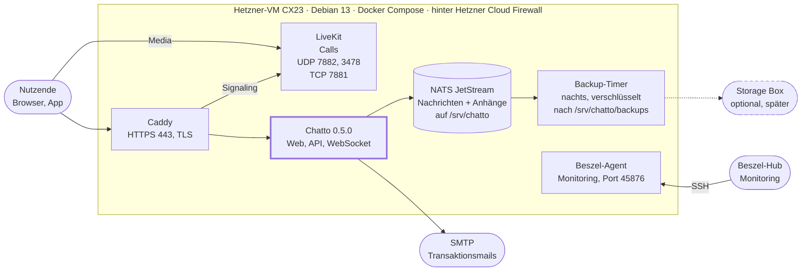

# Kalkspace Chatto – Designdokument für den PoC

Nov 20, 2026 · @Kai

## Ziel und Scope

Wir testen Chatto in einem Proof of Concept (PoC) als mögliche Alternative zu Slack für den Kalkspace. Der PoC soll zeigen, ob Chatto aus Sicht der Nutzenden und der Admins eine gute Lösung ist. Eine Entscheidung, von Slack zu migrieren, gibt es noch nicht: Darüber entscheidet das Plenum auf Basis der Erfahrungen aus dem PoC. Der PoC läuft auf der kleinsten sinnvollen Hetzner-Cloud-Instanz in Kais eigenem Hetzner-Projekt. Die Architektur entspricht trotzdem schon einem möglichen Produktivbetrieb: Fällt die Entscheidung positiv aus, bauen wir dasselbe Setup aus dem Repo in der Kalkspace-Infrastruktur (vermutlich ebenfalls Hetzner Cloud) neu auf.

Dieses Dokument ist die Vorgabe für die Umsetzung in einem Git-Repo (OpenTofu/Terraform, Ansible, Docker Compose).

**Im Scope**

- Ein Chatto-Server auf einer Hetzner-Cloud-VM, vollständig per Code reproduzierbar
- Chat, Dateien, Voice/Video-Calls (LiveKit), Web-Push
- Backups, Restore-Test, Basis-Monitoring, Update-Prozess

**Nicht im Scope des PoC**

- Hochverfügbarkeit, NATS-Cluster, mehrere Chatto-Replicas, Kubernetes, externer Object Storage (S3); S3 wird erst bei Bedarf ergänzt
- Zentrales Identity Management (SSO/OIDC)
- Die Entscheidung für einen Umstieg und eine echte Slack-Migration; der PoC liefert dafür nur die Grundlage, inklusive eines Import-Probelaufs

## Anforderungen und Annahmen

Die Last wäre auch im Produktivbetrieb klein: knapp 250 Accounts, davon 10–20 regelmäßig aktiv. Neben der Eignung für Nutzende und Admins soll der PoC zeigen, wie wenig Ressourcen Chatto dafür braucht.

| Anforderung | Festlegung |
| --- | --- |
| Nutzende | \~250 Accounts, 10–20 aktiv; Phase 1: eine Handvoll Tester:innen |
| Login | Lokale Accounts (E-Mail + Passwort), keine zentrale IdP |
| Registrierung | Offen: Selbstregistrierung per E-Mail ist erlaubt |
| Kosten | So niedrig wie möglich; Instanz nur bei Bedarf vergrößern |
| Verfügbarkeit | Best effort, Single Host; Ausfall von Minuten bis Stunden ist akzeptabel |
| Datenverlust | Maximal 24 h bei logischen Fehlern wie Bedienfehler oder kaputtem Update (tägliches Backup). Ein Verlust des Volumes ist in Phase 1 akzeptiert, weil die Backups auf demselben Volume liegen |
| Standort | Hetzner, Deutschland (FSN1 oder NBG1) |
| Reproduzierbarkeit | Alles per Code; das Setup muss sich jederzeit neu bauen lassen, auch in einem anderen Hetzner-Projekt |

**Annahmen**

- Domain: Der Test läuft unter `chat.cyb3rk4t.me`, das Ziel ist später `chat.kalk.space`. LiveKit liegt jeweils unter `livekit.chat.<domain>`; die Domain ist eine Variable.
- Es gibt einen SMTP-Zugang für Transaktionsmails (Registrierungscodes, Verifizierung, Passwort-Reset). Ohne SMTP funktioniert der lokale Login nicht sinnvoll.
- Betrieb durch 1–2 Admins aus dem Space, keine Bereitschaft.

## Architektur

Alle Komponenten laufen als ein Docker-Compose-Stack auf einer VM. Es gibt kein Postgres: Chattos Daten liegen in NATS JetStream, das als eigener Container läuft, ebenso alle Anhänge.



Caddy terminiert TLS für Chatto und das LiveKit-Signaling. Die Call-Medien gehen am Proxy vorbei direkt an LiveKit. Weil NATS getrennt von Chatto läuft, lässt sich Chatto neu starten oder aktualisieren, ohne den Datenspeicher anzufassen, und später ohne Umbau auf einen NATS-Cluster erweitern.

## Infrastruktur bei Hetzner

Wir starten mit einer CX23 (2 vCPU, 4 GB RAM, 40 GB Disk, x86) für rund 5,49 €/Monat zzgl. IPv4. Ist sie nicht bestellbar, nehmen wir die ARM-Variante CAX11 (gleiche Größe, rund 5,99 €). Chatto veröffentlicht seine Images auch für arm64.

Laut Berichten waren die Cost-Optimized-Typen (CX/CAX) zwischen August und Oktober 2026 zeitweise nicht bestellbar, und die nächstkleinere Alternative CPX22 kostet nach der Preiserhöhung vom Juni 2026 rund 19,49 €. Preise und Verfügbarkeit vor dem Anlegen im Hetzner-Portal prüfen. Der Servertyp ist deshalb eine Variable im Code.

| Ressource | Festlegung | Warum |
| --- | --- | --- |
| Server | `cx23`, Fallback `cax11`; Image Debian 13 | Kleinste Größe mit 4 GB RAM; Chatto hält Read-Models im Speicher |
| Swap | 2 GB Swapfile | Puffer gegen OOM-Kills bei Lastspitzen auf 4 GB |
| Volume | Hetzner Volume, 20 GB, ext4, unter `/srv/chatto` | Daten (Bind-Mounts für NATS und Caddy) und Backups überleben einen Neubau der VM |
| IP | Eine Primary IPv4 + IPv6, als eigene Ressource | IP bleibt bei Rebuild gleich, DNS muss nicht angepasst werden |
| Firewall | Hetzner Cloud Firewall (siehe unten) | Nur benötigte Ports offen, unabhängig von der Host-Konfiguration |
| DNS | `chat.<domain>` und `livekit.chat.<domain>` als A/AAAA | Caddy holt Zertifikate für beide Namen automatisch |
| Object Storage | Kein externer Object Storage; Anhänge liegen in NATS auf dem Volume | Einfachheit und keine Fixkosten; für die Community-Größe ausreichend |
| Offsite-Backup | Phase 1: keins, Backups nur auf dem Volume; später optional Storage Box | Geht das Volume verloren, sind auch die Backups weg; für den Test bewusst akzeptiert |

**Firewall-Regeln (eingehend)**

| Port | Protokoll | Quelle | Zweck |
| --- | --- | --- | --- |
| 22 | TCP | überall (nur Key-Login) | SSH |
| 80 | TCP | überall | ACME-Challenge, Redirect auf HTTPS |
| 443 | TCP | überall | Chatto und LiveKit-Signaling über Caddy |
| 7881 | TCP | überall | LiveKit ICE/TCP-Fallback |
| 7882 | UDP | überall | LiveKit Media (gemultiplext auf einem Port) |
| 3478 | UDP | überall | LiveKit TURN/STUN |
| 45876 | TCP | nur IP des Beszel-Hubs | Beszel-Agent (Hub verbindet sich per SSH), nur wenn aktiviert |

Alle anderen Ports bleiben zu, insbesondere NATS (4222) und Chatto (4000).

**Speicherplatz:** Weil die Anhänge in NATS liegen, enthält jedes tägliche Backup alle Dateien. Die Volume-Belegung wird überwacht, und das Volume wird bei Bedarf online vergrößert.

**Schutz vor Löschen:** Volume und Primary IP bekommen in OpenTofu `lifecycle { prevent_destroy = true }` und den Hetzner-Löschschutz. Das Volume hängt über eine eigene Attachment-Ressource an der VM, sodass die VM ersetzt werden kann, ohne Volume oder IP anzufassen. Ansible mountet das Volume über `/dev/disk/by-id/…` statt über Hetzners Automount.

## Chatto-Konfiguration

Basis ist das offizielle Beispiel `examples/dockercompose` aus dem Chatto-Repo (Stand v0.5.0 vom 9.11.2026). Die Upstream-`compose.yml` und die `Caddyfile` übernehmen wir unverändert. Alle Anpassungen kommen in eine eigene `compose.override.yml` und in die `.env`, damit sich Upstream-Änderungen leicht nachziehen lassen.

**Abweichungen vom Upstream-Beispiel**

- **Feste Versionen statt `latest`:** Chatto `0.5.0`, NATS, LiveKit und Caddy auf konkrete Tags gepinnt. Die Tags wählt die Umsetzung zum aktuellen Stand und trägt sie als Variablen ein.
- **Secrets nicht per `init-env.sh`:** Ansible erzeugt die Secrets beim ersten Lauf und legt sie verschlüsselt im Repo ab (Ansible Vault). Die `.env` und `livekit.generated.yaml` werden daraus gerendert. So bleiben die Secrets bei einem Neubau der VM gleich.
- **Speicherlimits pro Container** (Startwerte, im Test nachjustieren):

| Container | Limit | Hinweis |
| --- | --- | --- |
| chatto | 1536 MB | `GOMEMLIMIT` setzt Chatto automatisch auf 90 % des Limits |
| nats | 768 MB | JetStream mit `sync_interval: always` aus dem Upstream-Beispiel |
| livekit | 512 MB | Calls mit wenigen Teilnehmenden |
| caddy | 128 MB | Reverse Proxy und TLS |

Zusammen knapp 3 GB; der Rest bleibt für OS, Docker und Page Cache.

**Daten auf dem Volume:** Der Override ersetzt die benannten Docker-Volumes durch Bind-Mounts unter `/srv/chatto` (Compose führt Volumes mit gleichem Container-Pfad zusammen):

| Host-Pfad | Container | Inhalt |
| --- | --- | --- |
| `/srv/chatto/nats` | nats: `/data` | NATS JetStream inkl. Anhänge |
| `/srv/chatto/caddy/data` | caddy: `/data` | TLS-Zertifikate |
| `/srv/chatto/caddy/config` | caddy: `/config` | Caddy-Laufzeitkonfiguration |
| `/srv/chatto/backups` | chatto: `/backups` | Backup-Archive (Modus 700) |
| `/srv/chatto/import` | chatto: `/import` | Slack-Archive für den Import (Modus 700) |

Images, Container und Logs bleiben in Docker auf der Root-Disk; sie lassen sich jederzeit neu erzeugen.

**Wichtige Einstellungen**

| Bereich | Variable | Wert |
| --- | --- | --- |
| Owner | `CHATTO_OWNERS_EMAILS` | E-Mail des ersten Admin-Accounts |
| Registrierung | `CHATTO_AUTH_DIRECT_REGISTRATION` | `true` (Default), Selbstregistrierung offen |
| Login | `CHATTO_AUTH_DIRECT_LOGIN` | `true` (Default), da keine SSO |
| Mail | `CHATTO_SMTP_*` | SMTP mit STARTTLS auf 587 |
| Anhänge | `CHATTO_CORE_ASSETS_STORAGE_BACKEND` | `nats` (Default), kein externes S3 |
| Calls | `CHATTO_LIVEKIT_*` | aktiviert, URL `wss://livekit.chat.<domain>` |
| Push | `CHATTO_PUSH_ENABLED`, `CHATTO_PUSH_VAPID_*` | aktiviert; VAPID-Keys im Vault |
| Video | `CHATTO_VIDEO_ENABLED` | `false` (Transcoding braucht CPU, die wir nicht haben) |
| Operator-API | `CHATTO_OPERATOR_API_*` | wie Upstream; der Socket bleibt im Container |

Upload-Limits bleiben beim Default von 25 MB pro Datei.

## Betrieb

### Backup und Restore

Täglich läuft ein verschlüsseltes Chatto-Backup inklusive der Schlüssel; in Phase 1 bleibt es auf dem Volume. Ohne die Schlüssel sind die Nachrichten wegen der Verschlüsselung pro Account nicht wiederherstellbar.

1. Ein systemd-Timer führt täglich nachts `docker compose run --rm -T chatto backup --encrypt --include-keys --passphrase-stdin < /etc/chatto/backup-passphrase` aus. Die Passphrase-Datei hat Modus 600.
2. Das Archiv landet im Backup-Verzeichnis auf dem Volume (Modus 700). Ein Offsite-Sync (z. B. Storage Box) ist im Code vorbereitet, aber standardmäßig aus.
3. Die Anhänge liegen in NATS und sind damit in jedem Archiv enthalten. Aufbewahrung: 7 Tage, bei knappem Platz weniger.
4. `.env` und `livekit.generated.yaml` entstehen bei jedem Deploy aus dem Vault im Repo. Vault-Passwort und Backup-Passphrase liegen außerhalb des Servers im Passwortmanager (siehe Security).
5. Schlägt der Job fehl, geht eine Mail an die Admins (siehe Mailversand vom Host).
6. Der Restore wird vor dem Rollout einmal komplett durchgespielt: Archiv vorher lokal sichern, dann frische VM mit leerem Volume und Restore aus dem Archiv (siehe Phasen).

Regeln: `/srv/chatto/nats` nie im laufenden Betrieb kopieren und nie `docker compose down` ausführen, weil das NATS stoppt. Hetzner-Snapshots der VM sind nur ein Zusatz, kein Ersatz.

### Mailversand vom Host

Der Host verschickt Systemmails mit Debian-Standardpaketen über denselben SMTP-Server wie Chatto: `msmtp-mta` stellt `/usr/sbin/sendmail` bereit, `bsd-mailx` den Befehl `mail`. Zugangsdaten kommen aus dem Vault in `/etc/msmtprc` (Modus 600). Ein systemd-Template `notify-failure@.service` wird per `OnFailure=` an Backup und andere Timer gehängt; `unattended-upgrades` und cron nutzen denselben Weg. Die Mails gehen an einen Admin-Alias in `/etc/aliases`.

### Logs

Docker nutzt den Log-Treiber `local` (in `/etc/docker/daemon.json`), der Container-Logs selbst rotiert. Das systemd-Journal wird per `SystemMaxUse=500M` begrenzt. So kann die 40-GB-Root-Disk nicht volllaufen.

### Updates

- Versionen sind gepinnt; ein Update ist eine Änderung im Repo (Pull Request) plus ein Ansible-Lauf.
- Vor jedem Chatto-Update: Release Notes lesen, Backup ziehen, danach Logs und System-Seite im Admin prüfen. Bei 0.4 → 0.5 schreibt die Doku explizit kein Rolling Deployment vor; bei einem Single Host ist das ohnehin so.
- OS-Sicherheitsupdates per `unattended-upgrades`, Neustarts manuell im Wartungsfenster.

### Monitoring

- **Testprojekt: Beszel.** Der Beszel-Agent läuft als Container in einem eigenen Compose-Projekt der Rolle beszel, getrennt vom Chatto-Stack (`henrygd/beszel-agent`, gepinnt) mit Host-Netzwerk und Docker-Socket read-only. Kais bestehender Beszel-Hub verbindet sich per SSH zum Agent auf Port 45876 (`LISTEN=45876`); der Public Key des Hubs (`KEY`) liegt im Vault. Die Cloud Firewall lässt Port 45876 nur von der IP des Hubs zu.
- Das Volume wird zusätzlich unter `/extra-filesystems` in den Agent gemountet, damit Beszel dessen Belegung getrennt von der Root-Disk zeigt.
- Alarme im Hub: Root-Disk und Volume ab 80 % Belegung, RAM, System offline.
- Chatto-interne Werte (Streams, Projections, Worker, LiveKit) zeigt die System-Seite im Chatto-Admin.
- Für den Ressourcentest liefert Beszel den Verlauf von RAM und CPU pro Container. Dazu notieren wir die Startdauer von Chatto und die Größe der NATS-Daten.
- Späterer Betrieb: Monitoring nach dem, was der Kalkspace nutzt (offener Punkt). Der Beszel-Agent ist per Flag abschaltbar.

### Security

- SSH nur mit Keys; Root-Login ist erlaubt, Passwort-Login ist aus.
- Keine Host-Firewall: Die Hetzner Cloud Firewall ist die einzige Filterebene. Deshalb veröffentlicht Docker nur die Ports aus der Firewall-Tabelle.
- Secrets nur im Ansible Vault, nie im Klartext im Repo. Das Vault-Passwort liegt in Kais Passwortmanager und lokal als Datei außerhalb des Repos, auf die ansible.cfg verweist. Die Backup-Passphrase liegt zusätzlich getrennt im Passwortmanager. Vor dem Neuaufbau in der Kalkspace-Infra wandern beide ins Kalkspace-Bitwarden.
- Beim ersten Start Zugriff einschränken, bis der Setup-Wizard durch ist: Der erste Besucher kann Owner werden. Dafür ist `CHATTO_OWNERS_EMAILS` gesetzt, und der Wizard wird direkt nach dem Deploy durchlaufen.

**Rechte bei offener Registrierung:** Rollen und Raumgruppen werden in der Chatto-Weboberfläche eingestellt und stehen als Checkliste in der README, nicht in der Automatisierung. Neue Accounts bekommen nur eine Basisrolle; interne Kanäle liegen in einer eigenen Raumgruppe, da Raumgruppen in Chatto die Grenzen für Berechtigungen sind.

### Slack-Migration

Chatto bringt einen Slack-Import mit: Ein Konverter macht aus dem Slack-Export ein portables Archiv, das `chatto operator import` über die Operator-API einspielt. Im PoC proben wir den Import nur, um zu sehen, was mitkommt und was verloren geht. Eine echte Migration gibt es nur nach einer positiven Entscheidung im Plenum, dann in die neue Kalkspace-Instanz, bevor dort jemand schreibt. Testdaten nehmen wir nicht mit.

| Thema | Festlegung |
| --- | --- |
| Werkzeuge | `tools/slack/slack-export.py` aus dem Chatto-Repo (Python 3.11, `uv`) auf einem Admin-Rechner; danach `chatto operator import` im Chatto-Container |
| Ablauf | `--report-only` zeigt Blocker und Lücken, `--validate-only` prüft gegen das Ziel ohne Schreibzugriff, dann der Import mit `--accept-omissions` |
| Was mitkommt | Kanäle inkl. Thema und Sichtbarkeit, Mitgliedschaften, Nachrichten, Threads, Reaktionen, Dateien (Default bis 25 MiB pro Datei, 1 GiB Download pro Lauf) |
| Accounts | Slack-Username bleibt; keine Passwörter, keine Rollen. E-Mails kommen aus dem Export oder per temporärer Slack-App mit `users:read.email`; Chatto ordnet beim Import per E-Mail zu |
| Zielinstanz | Der Import legt neue Kanäle an und führt keine bestehende Historie zusammen; importierte Kanäle bis zum Abschluss nicht nutzen. Abgebrochene Läufe lassen sich mit gleichen Optionen fortsetzen |
| Infrastruktur | Ein Import-Verzeichnis auf dem Volume (`/srv/chatto/import`, Modus 700) wird in den Chatto-Container gemountet; Dateien landen über Chatto in NATS, das Volume vorher passend vergrößern. Für den Lauf die VM ggf. temporär vergrößern |
| Datenschutz | Export, Download-Cache und Archiv enthalten private Daten: nie ins Git-Repo, nach der Migration löschen |

Das Archivformat ist laut Chatto noch ein Entwurf. Der Probelauf soll zeigen, was verloren geht, bevor wir uns festlegen.

## Repo-Struktur und Umsetzungsvorgaben

Das Repo hat drei Schichten mit klarer Grenze: OpenTofu legt die Hetzner-Ressourcen an, Ansible richtet den Host ein und deployt, Docker Compose betreibt die Anwendung.

```text
kalkspace-chatto/
├── README.md                  # Bootstrap, Deploy, Backup, Restore, Update
├── justfile                   # plan, apply, deploy, backup-now, restore
├── docs/design.md             # dieses Dokument
├── terraform/
│   ├── main.tf                # Server, Primary IP, Volume, Firewall, SSH-Key
│   ├── dns.tf                 # optional, nur wenn die Zone bei Hetzner DNS liegt (Test: extern, manuell)
│   ├── variables.tf           # hcloud_token, server_type, location, beszel_hub_ip, domain
│   └── outputs.tf             # IPs, erzeugt Ansible-Inventory
├── ansible/
│   ├── site.yml
│   ├── reset.yml              # nur Test: NATS-Daten leeren
│   ├── inventory/             # aus Terraform-Output generiert
│   ├── group_vars/all/
│   │   ├── vars.yml           # Versionen, Domain, Limits, Feature-Flags
│   │   └── vault.yml          # Secrets (Ansible Vault)
│   └── roles/
│       ├── base/              # Debian 13, Updates, SSH nur mit Keys, Swap, msmtp
│       ├── volume/            # Hetzner Volume mounten
│       ├── docker/            # Docker Engine + Compose v2 aus dem Docker-Repo
│       ├── chatto/            # Compose-Stack, .env, LiveKit-Config, Deploy
│       ├── backup/            # systemd-Timer, optional Offsite, Fehler-Mail
│       └── beszel/            # Beszel-Agent (eigenes Compose-Projekt), per Flag abschaltbar
└── compose/
    ├── compose.yml            # unverändert aus Upstream v0.5.0
    ├── Caddyfile              # unverändert aus Upstream v0.5.0
    ├── nats-server.conf       # unverändert aus Upstream v0.5.0
    ├── compose.override.yml   # Pins, Speicherlimits, Bind-Mounts
    ├── env.j2                 # Template für .env
    └── livekit.yaml.j2        # Template für die LiveKit-Config
```

**Vorgaben für die Umsetzung**

1. OpenTofu mit dem `hcloud`-Provider; State zunächst lokal und per .gitignore aus dem Repo heraus; ein Remote-Backend kommt beim Umzug in die Kalkspace-Infra.
2. Kein eigenes cloud-init: Den SSH-Key für root hinterlegt Hetzner über hcloud\_ssh\_key am Server, und Ansible verbindet sich als root. Das Hetzner-Image bringt Python mit, das beim ersten Lauf geprüft wird; fehlt es, installiert Ansible es per raw-Modul nach. Alles andere ist idempotentes Ansible, damit Konfigurationsänderungen ohne Rebuild gehen.
3. Ansible muss gegen eine frische VM mit vorhandenem Volume laufen können und dabei bestehende Daten unangetastet lassen (Rebuild-Szenario).
4. Die Ansible-Rolle `chatto` startet Container mit `docker compose up -d` und verwendet nie `down`.
5. Upstream-Dateien werden mit Herkunft und Version im Kopf kommentiert, damit Updates als Diff nachvollziehbar sind.
6. Feature-Flags in `vars.yml`: `chatto_push_enabled`, `chatto_direct_registration`, `backup_offsite_enabled`, `beszel_agent_enabled`. LiveKit ist fester Bestandteil und hat kein Flag.
7. Ein `justfile` mit den Rezepten `plan`, `apply`, `deploy`, `backup-now` und `restore <archiv>`. Wir nehmen `just` statt `make`, weil keines der Ziele Dateien erzeugt. Außerdem nimmt `just` Argumente direkt entgegen (z. B. das Archiv beim Restore), und Rezepte laufen als zusammenhängendes Shell-Skript. `just --list` zeigt alle Rezepte mit Beschreibung. `just` steht neben OpenTofu und Ansible in der README unter den Voraussetzungen (`brew install just` bzw. `apt install just`).
8. README beschreibt den Erstaufbau Schritt für Schritt inklusive Setup-Wizard und Restore. Reihenfolge: OpenTofu anwenden, dann die DNS-Records setzen und prüfen, dass sie auflösen, dann der Ansible-Deploy, dann sofort den Setup-Wizard durchlaufen. Ohne auflösende DNS-Records scheitert Caddy beim Zertifikat.

**Zwei Umgebungen aus einem Repo:** Alles Umgebungsspezifische (Hetzner-Token, Domain, Owner-Mail, SMTP) liegt in Variablen bzw. im Vault. Dasselbe Repo deployt so erst ins Testprojekt unter `chat.cyb3rk4t.me` und später in die Kalkspace-Infra unter `chat.kalk.space`.

**Testinstanz zurücksetzen:** Das Playbook `reset.yml` stoppt Chatto und NATS, leert `/srv/chatto/nats` und startet beides neu. Es läuft nur, wenn die Umgebung als Test markiert ist, und fragt vorher nach einer Bestätigung. Zertifikate und Backups bleiben erhalten.

## Phasen und offene Entscheidungen

Der PoC umfasst die Phasen 1 bis 4 und endet mit der Entscheidung im Plenum. Nur bei einer positiven Entscheidung folgen die Phasen 5 und 6. Jede Phase endet mit einer Prüfung, bevor die nächste beginnt.

1. **Aufbau im Testprojekt:** Repo, VM und Stack unter `chat.cyb3rk4t.me` in Kais Hetzner-Projekt; Owner-Account angelegt, Backup läuft. Fertig, wenn zwei Tests klappen: ein Neubau der VM mit vorhandenem Volume, bei dem alle Daten erhalten bleiben, und ein Restore-Test. Dafür das Backup-Archiv vorher lokal sichern, dann mit frischem, leerem Volume neu bauen und aus dem Archiv wiederherstellen.
2. **Test mit 5–10 Leuten (ca. 4 Wochen):** Chat, Dateien, Calls, Push auf Desktop und Handy nutzen. Fertig, wenn diese Kriterien erfüllt sind:
   - Chatto-Container bleibt unter seinem Speicherlimit, ohne OOM-Kill.
   - Ein Call mit 4–5 Teilnehmenden läuft stabil, auch aus dem Mobilfunknetz.
   - Nachrichten kommen ohne spürbare Verzögerung an; Push funktioniert.
   - Das Backup läuft jeden Tag durch, und das Volume hat genug Reserve.
   - Feedback der Tester:innen und der Admins ist gesammelt, z. B. per kurzer Umfrage.
3. **Probelauf Slack-Import im Testprojekt:** Export konvertieren, Report prüfen, in eine frisch zurückgesetzte Testinstanz importieren und Ergebnis, Dauer und Ressourcenbedarf notieren. Dabei die Größe der Slack-Dateien ermitteln; sie bestimmt die Volume-Größe und ob S3 doch nötig wird. Fertig, wenn die Lücken bekannt sind.
4. **Entscheidung im Plenum:** Erfahrungen der Nutzenden und Admins, Ressourcenbedarf und Ergebnis des Import-Probelaufs zusammenfassen und im Plenum vorstellen. Fällt die Entscheidung negativ aus, wird das Testprojekt abgebaut.
5. **Neuaufbau in der Kalkspace-Infra** (nur nach positiver Entscheidung): dasselbe Repo in einem Kalkspace-Hetzner-Projekt unter `chat.kalk.space` ausrollen, leer und ohne Testdaten; Instanzgröße anhand der Messwerte festlegen.
6. **Slack-Migration und Rollout an alle (\~250 Accounts):** frischen Export importieren, Accounts aktivieren, Leute einladen, Slack auf Lesezugriff stellen.

**Offene Entscheidungen**

- [ ] **Aktivierung importierter Accounts:** Wie bekommen importierte Slack-Accounts (ohne Passwort) Zugang, etwa per Passwort-Reset-Mail? Und wird eine Selbstregistrierung mit derselben E-Mail dem importierten Account zugeordnet?
- [ ] **SMTP-Zugang:** Welcher Mailserver bzw. Account wird für Transaktionsmails genutzt, im Test und später im Kalkspace?
- [ ] **DNS:** `cyb3rk4t.me` liegt extern, die Records werden dort manuell gesetzt. Wo liegt das DNS von `kalk.space`?
- [ ] **Slack-Plan und Umfang:** Welchen Slack-Plan hat der Kalkspace, und welche Daten bekommen wir damit in den Export (öffentliche Kanäle, private Kanäle, DMs, wie weit zurück)? Welche Kanäle sollen mit?
- [ ] **Offsite-Backup (später):** Storage Box oder vorhandener Speicher im Space? Spätestens vor dem Rollout an alle klären.
- [ ] **Monitoring im späteren Betrieb:** Was nutzt der Kalkspace für Monitoring und Alarme? Danach richtet sich, ob Beszel bleibt oder ersetzt wird.
- [ ] **Update-Prozess für gepinnte Versionen (später):** Renovate im Repo einrichten, das für neue Versionen von Chatto, NATS, LiveKit, Caddy und Beszel automatisch Pull Requests öffnet. Dazu ein Watch auf Chattos GitHub-Releases und Security Advisories.
- [ ] **Ablage des OpenTofu-States im Kalkspace-Betrieb:** Im Test liegt der State lokal. Für den Betrieb durch mehrere Admins braucht es einen gemeinsamen Ort. Möglich sind ein S3-Backend (z. B. Hetzner Object Storage mit Lockfile), das HTTP-Backend einer vorhandenen GitLab- oder Forgejo-Instanz des Space, oder ein mit OpenTofu State Encryption verschlüsselter State direkt im Repo. Vor dem Neuaufbau in der Kalkspace-Infra klären.

## Quellen

- [Chatto-Dokumentation](https://docs.chatto.run)
- Chatto Docs: [Docker-Compose-Deployment](https://docs.chatto.run/guides/deployment/docker-compose/)
- Chatto Docs: [Horizontal Scaling](https://docs.chatto.run/guides/infrastructure/horizontal-scaling/)
- Chatto Docs: [Media & Attachments](https://docs.chatto.run/guides/infrastructure/media-attachments/)
- Chatto Docs: [Server Operations](https://docs.chatto.run/guides/operations/server-operations/)
- [Chatto-Repo, examples/dockercompose (v0.5.0)](https://github.com/chattocorp/chatto)
